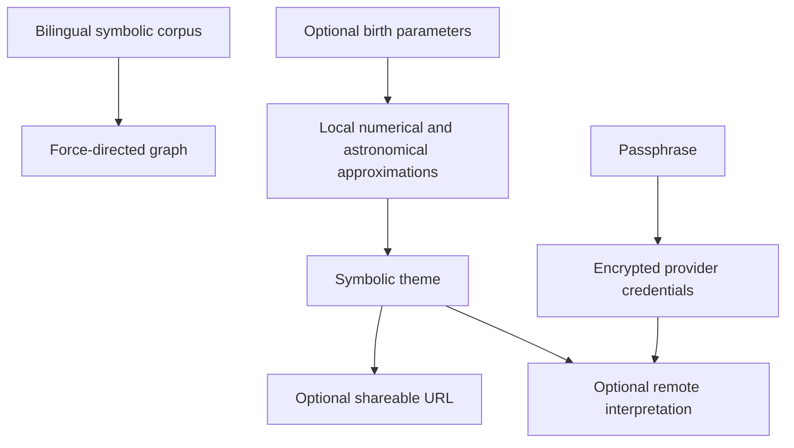

# L’Œil d’Hermès — grimoire numérique

**Creation: Lyssa Jung and Niko — Studio Niko Design**

[Source](index.html) · [Licence](LICENSE.md) · [English overview](#english-overview)

## Architecture constatée



Le calcul local utilise le jour julien, les longitudes solaire et lunaire approximatives, le temps sidéral et une formule trigonométrique pour l'ascendant. L'heure inconnue est remplacée par midi pour certains calculs ; l'ascendant nécessite heure et coordonnées. Les angles et leur précision doivent être comparés à des éphémérides indépendantes, notamment aux latitudes extrêmes et frontières de signe. La simulation de forces sert à visualiser les correspondances, pas à démontrer leur validité scientifique.

Grimoire numérique : 69 notions d'alchimie, d'astrologie, de kabbale et de tarot, reliées entre elles par leurs correspondances, avec un module de calculs de nombres et de positions.

Création : Lyssa Jung et Niko — Studio Niko Design.

## Contenu

| Fichier | Rôle |
|---|---|
| `index.html` | L'application entière : données, styles, moteur, calculs |
| `sw.js` | Service worker, mise en cache de la coquille |
| `manifest.webmanifest` | Manifeste PWA |
| `icone.svg`, `icone-maskable.svg` | Icônes |

## Ce qui est calculé localement

Chemin de vie, nombre du jour de naissance, année personnelle, position du Soleil et son décan, position de la Lune, phase lunaire natale, ascendant, prochaine révolution solaire. Aucun de ces calculs n'utilise le réseau.

Précisions : Soleil et Lune approximatifs (série lunaire tronquée), ascendant calculé avec l'heure, le décalage UTC, la latitude et la longitude ; aucune précision certifiée. Les positions situées à moins de 1,5° d'une frontière de signe sont signalées comme incertaines.

## Lieu de naissance et décalage horaire

Un champ ville renseigne la latitude, la longitude et le décalage UTC. La table encode des hypothèses historiques sur l'heure d'été française, à vérifier indépendamment : aucune de 1945 à 1975, dates propres à chaque année de 1976 à 1980, dernier dimanche de mars au dernier dimanche de septembre de 1981 à 1995, puis à octobre depuis 1996. Le décalage proposé reste modifiable : c'est une aide à la saisie, pas une autorité.

## Le graphe

Une simulation de forces place les 69 nœuds et leurs correspondances. Elle s'arrête d'elle-même une fois stabilisée, et se résout en un seul calcul si le système demande une réduction des animations.

## Ce qui passe par un modèle

Uniquement la lecture interprétée, et seulement si vous enregistrez une clé. Fournisseurs tentés dans l'ordre : Mistral, Groq, Cerebras.

Les clés sont chiffrées en AES-256-GCM, la clé de chiffrement étant dérivée d'une phrase de passe par PBKDF2-SHA-256 à 210 000 itérations. Le stockage ne contient que le sel, le vecteur d'initialisation et le chiffré. La phrase de passe n'est gardée qu'en mémoire, le temps de l'onglet. Une phrase perdue rend la clé irrécupérable : il faut la ressaisir.

Cela protège la clé d'une lecture directe du stockage, pas d'un code malveillant exécuté dans la page. Sur un site public, n'utilisez qu'une clé révocable.

## Langues

Interface et contenu complets en français et en anglais. La langue suit celle du navigateur au premier lancement, puis le choix fait dans l'en-tête, conservé sur l'appareil. La recherche interroge les deux langues à la fois : `sulphur` trouve Soufre même en mode français.

Pour ajouter une langue, il suffit d'un objet de même forme que `EN` dans `index.html` (`{ id: {n, s, t} }`) et d'une entrée dans `UI`. Rien d'autre à toucher.

## Partager un thème

Le bouton « Copier le lien du thème » encode la saisie dans l'URL. Le lien rouvre l'application et recalcule le thème, sans base de données ni compte.

## Tests

`node test/smoke.js` monte la page dans un DOM simulé et vérifie l'index, la recherche bilingue, les filtres, la réciprocité des correspondances, les décalages horaires, les huit blocs du thème, le lien partageable, le graphe et la bascule de langue. Le workflow GitHub Actions le rejoue à chaque push sur `main`.

```bash
npm install jsdom --no-save && node test/smoke.js
```

## Mise en ligne

GitHub Pages sert le dépôt tel quel. La PWA ne s'installe qu'en HTTPS : en `file://`, l'application fonctionne mais sans installation ni service worker.

```bash
git init
git add .
git commit -m "L'Œil d'Hermès — grimoire, calculs, PWA"
git branch -M main
git remote add origin https://github.com/Nikoju1977/oeil-hermes.git
git push -u origin main
```

Puis, dans les réglages du dépôt : Pages → Source → `main` / `/ (root)`.


## Qualification proposée

Vérifier le graphe, la recherche bilingue, les dates historiques, les fuseaux et les angles sur des références indépendantes, ainsi que les comportements aux limites. Contrôler les erreurs des fournisseurs et la restauration des clés chiffrées. Les liens de partage encodent les paramètres de naissance : ne pas partager un lien contenant des informations personnelles sans accord. Les lectures distantes peuvent transmettre le contexte choisi. Aucun nouveau test, calcul comparatif ni appel API effectué.

## English overview

L’Œil d’Hermès is a bilingual symbolic knowledge graph created by Lyssa Jung and Niko. It includes local numerology and approximate astronomical calculations, optional remote AI interpretation and passphrase-encrypted credentials. Astronomical precision and historical timezone assumptions need independent validation. Symbolic associations do not establish scientific or predictive claims. Sharing a theme may disclose birth parameters. No new runtime or deployment validation was performed.

[Notice de droits](LICENSE.md) : droits et crédits existants préservés.
